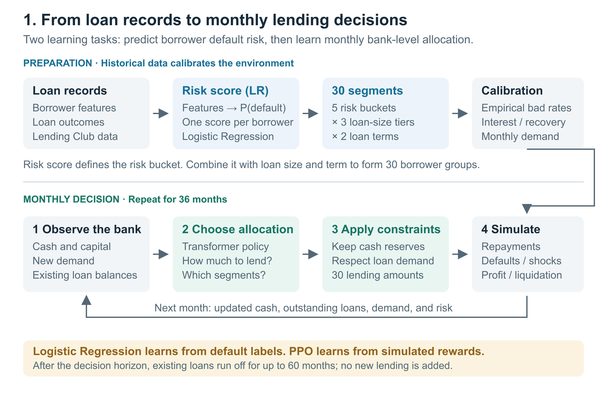
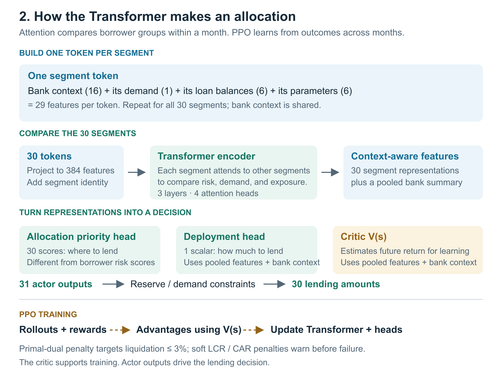
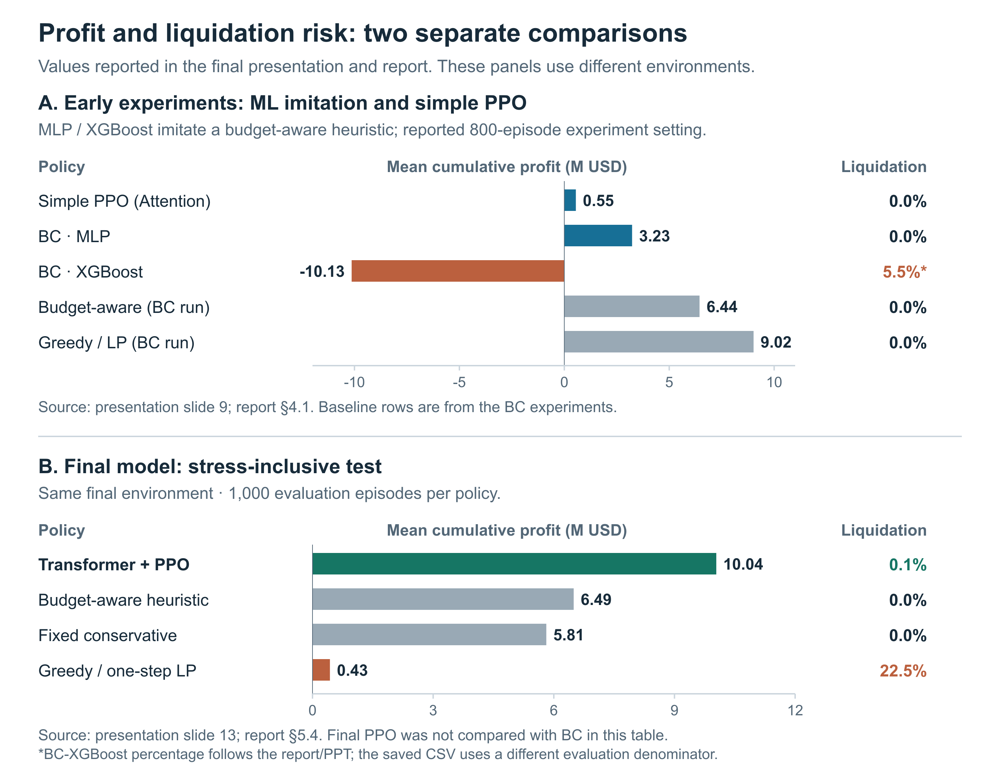

# Reinforcement Learning for Bank Capital Allocation

*Monthly lending allocation under liquidity and capital constraints*
*강화학습을 활용한 은행의 월간 자산 배분*

**DGIST · CSE402 Reinforcement Learning · Spring 2026**  
Three-person team project · Instructor: Prof. Doo-Seok Lee

**My role (Jeong-Ho SEO):** Initial problem formulation and model design in the Week 10 proposal, followed by Week 13 comparisons of **PPO vs. Behavioral Cloning, Attention vs. GRU, and Logistic Regression vs. XGBoost**. I modified the shared code for these experiments and contributed experiment analysis and reporting. **Hu-yeon Cho** led the main code development and final model design. **Jae-hwan Kim** corrected the baselines' cash-buffer logic and contributed result analysis.

**Key result:** In the stress-inclusive test, short-horizon Greedy/LP allocation suffered **22.5% liquidation**, compared with **0.1% for PPO**. PPO also earned more than conservative heuristics, showing that low liquidation risk need not come from avoiding lending. Across the eight reported scenarios, PPO maintained positive mean profit and liquidation rates of **0–1.7%** within the calibrated simulator.

## 1. Motivation

A lender must decide each month how much capital to allocate across borrowers with different risks, loan sizes, and maturities. High-interest loans can increase short-term returns, but capital committed today remains tied up for months. Correlated defaults or delayed repayments can leave an otherwise profitable lender unable to meet its liquidity requirement.

This motivated a sequential decision-making problem: **can an allocation policy improve long-term profitability while keeping liquidation risk low?** My initial proposal connected borrower risk scores to loan conditions and defined the liquidity–profit trade-off. The final team framework focused on bank-level allocation across **30 borrower segments**.

Historical loan records do not reveal what would have happened under alternative lending decisions. We therefore used Lending Club data to **calibrate a simulator**, then trained and evaluated policies through simulator rollouts. The results describe performance within this environment, rather than demonstrated returns in the real lending market.

## 2. Experiment Design

### Data and Evaluation

| Item | Final experiment setting |
| --- | --- |
| Dataset | Lending Club accepted loans, 2007–2018 |
| Chronological split | Train: Jun 2007–Jun 2015; validation: Jul 2015–Oct 2017; test: Nov 2017–Dec 2018 |
| Risk model | Logistic Regression; validation AUC **0.695**, test AUC **0.677** |
| Borrower segments | 5 risk buckets × 3 amount tiers × 2 loan terms = **30 segments** |
| Initial cash | **$50 million** |
| Episode | 36 monthly lending decisions, followed by up to 60 months of loan-book runoff |
| Final policy training | **4,096 episodes** |
| Final evaluation | **1,000 Monte Carlo episodes per policy and scenario** |
| Metrics | Mean cumulative profit, liquidation rate, 5% CVaR, liquidity and capital ratios |

The risk model excludes repayment outcomes and historical lending-policy variables such as `int_rate`, `installment`, `grade`, and `sub_grade`. Interest rates and related variables remain available for economic calibration. Segment default probabilities are estimated from empirical bad-loan rates.

Policies are evaluated using the same episode seed lists to reduce noise in comparisons. The final evaluation covers validation, test, low-stress test, and five additional scenarios: **default ×2, high-risk demand ×1.5, initial liquidity ×0.7, recovery ×0.5, and combined stress**.

### A. Comparison Experiments — My Implementation

Starting from the team's data processing, segment calibration, and simulator, I compared three parts of the decision pipeline.

| Experiment | Models | Question |
| --- | --- | --- |
| Policy learning | PPO, BC-MLP, BC-XGBoost | How does reward-based learning compare with imitating a heuristic? |
| Actor architecture | Segment Attention, GRU | Does changing the segment representation improve allocation? |
| Risk scoring | Logistic Regression, XGBoost | How does the upstream risk model affect downstream profit? |

1. Train the baseline Attention PPO for **800 episodes**.
2. Collect **800 episodes** of state–action pairs from a budget-aware heuristic. Train an MLP or XGBoost model to imitate these actions; use 50 training epochs for the MLP.
3. Replace the Attention actor with a GRU and compare allocation performance.
4. Replace the Logistic Regression risk scorer with XGBoost and repeat Attention PPO training.

Behavioral Cloning learns the **heuristic's actions**, rather than independently discovering an optimal policy. The GRU experiment explored an alternative sequential representation; its profit improvement alone does not establish that it learned long-term temporal dependencies.

### B. Final Framework — Team Contribution

The final framework incorporates persistent economic regimes, clustered defaults, liquidity shocks, and **segment fatigue**, where repeated concentration increases future risk. These changes extend both the policy and the environment, so improvement over the initial experiments cannot be attributed to the network architecture alone.

| Baseline | Allocation rule |
| --- | --- |
| Reject all | Make no new loans and retain cash |
| Fixed conservative | Focus on the lowest two risk buckets with a 55% deployment fraction |
| Fixed aggressive | Allocate across broader risk buckets with a 90% deployment fraction |
| Budget-aware heuristic | Adjust eligible risk buckets and deployment according to liquidity |
| Greedy / one-step LP | Allocate by expected profit until safe capacity is exhausted; both yield the same solution under linear returns and one budget constraint |

## 3. Methodology

### Risk Scoring and Segment Calibration

The final framework has **two distinct learning tasks**. Logistic Regression predicts borrower risk before policy training. The Transformer policy, trained by PPO, decides how to allocate the bank's capital each month.

  

*Figure 1. Borrower risk prediction, segment calibration, and monthly capital allocation. [Vector version](assets/framework-overview.svg).*

1. **Predict borrower risk with Logistic Regression.** Application-time features produce a scalar estimated default probability, or **risk score**. Historical default outcomes provide supervised training labels. The score summarizes many borrower attributes and orders borrowers by risk.
2. **Form 30 borrower segments.** Divide borrowers into five risk buckets, then combine these with three loan-size tiers and two loan terms. For example, low-risk borrowers requesting small, short-term loans form one segment.
3. **Calibrate the simulator.** Estimate each segment's default rate from its **observed bad-loan rate**, together with interest, recovery, and demand parameters. The predicted risk score determines grouping; it is not simply substituted for the empirical segment default rate.

This separation gives each model a specific job. Logistic Regression provides a compact, interpretable risk estimate. It does not optimize the bank's lending decisions. PPO learns allocation from simulated profit and risk over time. The **BC-MLP and BC-XGBoost models are alternative allocators in the comparison experiments**, while the XGBoost risk-scorer experiment is a separate replacement for Logistic Regression.

| Quantity | Produced by | Role |
| --- | --- | --- |
| **Borrower risk score** | Logistic Regression | Estimated default probability used to assign a risk bucket |
| **Risk-adjusted expected profit rate (RA-EPR)** | Simulator economics and risk assumptions | Segment attractiveness after modeled risk costs; used in allocation constraints and scoring |
| **Allocation priority score** | Transformer actor | Learned preference for distributing this month's lending across segments |

### Monthly Lending MDP

The policy distributes money across borrower groups rather than deciding each individual application. The pipeline is **risk prediction → segment calibration → lending simulation → policy learning and evaluation**.

The **406-dimensional state** combines the bank's current position with segment-level demand, exposure, and risk:

| State component | Dimensions | Information |
| --- | ---: | --- |
| Global state | 16 | Cash, capital, liquidity coverage, capital adequacy, remaining horizon, and economic regimes |
| Segment demand | 30 | Current monthly demand in each segment |
| Outstanding exposure | 180 | Loan balances across 30 segments and 6 remaining-maturity buckets |
| Segment parameters | 180 | Expected profit, stress sensitivity, duration pressure, risk-adjusted profit, opportunity readiness, and fatigue |

The actor produces **31 raw outputs**: one deployment scalar and 30 allocation priority scores. These scores are distinct from the borrower default-risk scores above. The environment converts these into a **30-dimensional lending allocation**, limited by segment demand and available cash. The selected checkpoint uses a `direct` action mode with a `rank_fill` decoder.

Required liquidity increases with outstanding exposure. Deployable capital is calculated as:

$$
L_t^{\mathrm{required}} = B_{\min} + \kappa\,\mathrm{Exposure}_t,
\qquad
C_t = \max\left(0,\frac{B_t-L_t^{\mathrm{required}}}{1+\kappa}\right).
$$

Here, $B_t$ is current cash, $B_{\min}$ is the minimum reserve (**$10M**), and $\kappa=0.05$. Repayments, defaults, costs, shocks, and new lending determine the next cash balance and loan book.

### Transformer Policy Trained with PPO

  

*Figure 2. Segment tokens, the allocation policy, and PPO training. Based on report §3.2–3.5, presentation slides 6–7, and the final implementation. Final model design led by Hu-yeon Cho. [Vector version](assets/policy-explained.svg).*

**Why a Transformer?** Lending opportunities compete for the same cash. Attention lets each segment be evaluated in relation to the others. Here, tokens represent **borrower segments within a month**, rather than a sequence of months. **PPO** is the algorithm that trains this policy using rewards across monthly decisions.

1. Build **30 segment tokens**, each containing 16 shared bank features plus its own demand (1), maturity-bucket exposures (6), and segment parameters (6). Project each 29-feature token to hidden size **384**, then apply **3 Transformer layers** with **4 attention heads**.
2. Predict **30 segment scores** for where to lend and **one deployment scalar** for how much to lend. A separate critic estimates future return $V(s)$ for training; it does not choose the allocation.
3. Collect simulator rollouts and estimate advantages with GAE. Update the actor and critic using PPO's clipped objective, value loss, and entropy bonus.
4. Apply a **primal-dual penalty** targeting a liquidation rate of at most **3%**. Add soft penalties when liquidity coverage and capital adequacy fall below buffer targets of **1.05** and **0.10**.

Training uses $\gamma=0.99$, GAE $\lambda=0.95$, a PPO clip of $0.2$, and a learning rate of $10^{-5}$. Early training uses teacher guidance, which is removed later in the guided-to-pure curriculum. The final dual penalty is approximately **1.26**.

### Stress and Liquidation

An AR(1) regime with persistence $\rho=0.85$ drives changes in demand and default risk. Stress can cause cash drains, higher funding costs, capital losses, clustered defaults, and delayed repayments. Segment fatigue discourages repeated concentration, while recovery regimes introduce new lending opportunities.

An episode terminates when **capital adequacy falls below the simulator's 8% floor** or **cash falls below required liquidity**. Liquidity liquidation applies a **60% haircut** to current assets, with no subsequent runoff credit. These thresholds are simplified modeling assumptions.

Reported profit is a simulator-defined measure. In addition to interest, default losses, costs, and liquidation losses, the final implementation includes modeled **opportunity capture value** and **fatigue franchise cost**.

## 4. Results

### Profitability and Robustness under Stress

The central result is **profitable lending with low liquidation risk under simulated stress**. Greedy/LP pursues high current expected returns but does not fully account for future concentration, liquidity, and capital risk. In the final test, its liquidation rate reached **22.5%**, while PPO achieved **$10.04M mean profit with 0.1% liquidation**.

This was not simply a no-lending strategy: the report records **$8.99M in default losses for PPO**, versus **$6.11M for fixed conservative**, alongside higher PPO profit. This is consistent with taking meaningful credit risk while managing liquidation risk; it does not establish equal deployment volumes. Conservative heuristics also remained safe, but earned less.

  

*Figure 3. Comparisons from presentation slides 9 and 13 and report §4.1 and §5.4, redrawn for readability. Initial ML experiments and final stress evaluation use different environments; they do not establish a direct final-PPO-versus-BC robustness ranking. [Vector version](assets/robustness-comparison.svg).*

### My Comparison Experiments

Results below follow **Section 4.1 of the final report and the presentation**. Profit is mean cumulative profit in USD; liquidation counts and percentages retain the report's notation.

| Learned policy | Cumulative profit | Liquidations, as reported | Best baseline profit in the same experiment |
| --- | ---: | ---: | ---: |
| PPO · LR + Attention | 550,399 | 0 (0%) | 8,455,709 |
| PPO · LR + GRU | 977,134 | 0 (0%) | 8,455,709 |
| PPO · XGBoost + Attention | 1,351,510 | 0 (0%) | 8,626,979 |
| BC · MLP | 3,230,155 | 0 (0%) | 9,019,565 |
| BC · XGBoost | −10,134,452 | 44 (5.5%) | 9,019,565 |

BC-MLP performed best among the learned policies, but remained below the heuristic it imitated. GRU and XGBoost scoring improved PPO profit without surpassing Greedy/LP. **Changing the actor or risk scorer alone was insufficient to beat strong heuristics**, motivating a framework that explicitly models future liquidity and capital risk.

*Source note: the report's BC-XGBoost liquidation percentage differs from the saved CSV's evaluation denominator. The report and presentation values are retained here, as the primary sources for this summary.*

### Final Team Model

**Test results:** 1,000 episodes per policy. Monetary values are in USD. The 5% CVaR is the average profit in the worst 5% of episodes; a higher value indicates a smaller tail loss.

| Policy | Cumulative profit | Liquidation rate | 5% CVaR |
| --- | ---: | ---: | ---: |
| **Transformer + PPO** | **10,039,693** | **0.1%** | −6,204,228 |
| Budget-aware heuristic | 6,494,083 | 0.0% | −6,176,771 |
| Fixed conservative | 5,813,232 | 0.0% | −6,269,750 |
| Fixed aggressive | 5,464,896 | 0.0% | −7,207,517 |
| Greedy / one-step LP | 433,248 | 22.5% | −30,432,738 |
| Reject all | −3,577,121 | 0.0% | −3,577,121 |

PPO earned **$3.55M more mean profit (+54.6%)** than the best baseline. Its 5% CVaR was substantially better than Greedy/LP's, but slightly worse than the budget-aware heuristic's. The evidence supports a favorable profit–liquidation trade-off, rather than superiority on every risk measure.

**Scenario results:** values reproduced from the final report, with 1,000 episodes per scenario. Profit and margins are in USD.

| Scenario | PPO profit | Best baseline profit | PPO margin | PPO liquidation rate |
| --- | ---: | ---: | ---: | ---: |
| Validation | 13,077,976 | 10,328,166 | +2,749,810 | 0.0% |
| Test | 10,039,693 | 6,494,083 | +3,545,610 | 0.1% |
| Low-stress test | 12,061,410 | 8,279,435 | +3,781,975 | 0.6% |
| Default ×2 | 1,114,907 | 1,114,551 | +355 | 0.0% |
| High-risk demand ×1.5 | 11,296,339 | 6,859,169 | +4,437,170 | 0.5% |
| Initial liquidity ×0.7 | 6,134,946 | 3,339,949 | +2,794,997 | 1.7% |
| Recovery ×0.5 | 8,957,145 | 6,128,227 | +2,828,919 | 0.7% |
| Combined stress | 2,789,313 | 2,489,297 | +300,016 | 0.0% |

Across all eight scenarios, PPO combined **positive mean profit with 0–1.7% liquidation**, including the combined-stress case. The largest margin was under high-risk demand. The default ×2 margin was only **$355**, so that small difference alone does not establish statistically significant superiority.

**Limitations:** Results depend on simulator assumptions, including stress, fatigue, and opportunity-value terms. Accepted loans may not represent the full applicant population. The initial and final experiments also differ in environment and training settings, so their profit difference is not a controlled estimate of the architecture's contribution.

### Project Files and Code Versions

**Which version should I read?** Start with **[`week14_RL-main_3`](week14_RL-main_3)** among the three development versions. For the same code together with final model artifacts and evaluation outputs, use **[`week15_Project_Final_Result/Code_Data/RL-main_codes`](week15_Project_Final_Result/Code_Data/RL-main_codes)**. The 12 Python source files in these two directories are identical.

| Directory | Purpose |
| --- | --- |
| [`week10_Proposal`](week10_Proposal) | Initial problem formulation and model design |
| [`week11_RL-main_1/RL`](week11_RL-main_1/RL) | Earlier segment PPO implementation with a 331-dimensional state |
| [`week13_Experiments/Baselines`](week13_Experiments/Baselines) | My policy, actor, and risk-scorer comparison experiments |
| [`week14_RL-main_2`](week14_RL-main_2) | Intermediate framework with primal-dual and residual-policy options |
| **[`week14_RL-main_3`](week14_RL-main_3)** | **Recommended development version; matches the final submitted Python code** |
| [`week15_Project_Final_Result`](week15_Project_Final_Result) | Final report, presentation, submitted code, data, and results |

The week numbers follow the archive's folder names. They do not establish exact development dates or authorship of individual edits.

**Code reading order:** `train_segment_ppo.py` for the overall pipeline → `lending_rl_agent/data.py` for preprocessing and scoring → `segment_simulator.py` and `torch_segment_simulator.py` for the environment → `ppo.py` for the policy and training algorithm. The last three files are also under `lending_rl_agent/`.

- [Dataset download](\https://drive.google.com/drive/folders/1_uwVd9zwkKQcZXy6IqhEkNAyuWlJVgb7?usp=sharing)
- Team report: [DOCX](week15_Project_Final_Result/Final_Report_Week15_ver2.docx) · Team presentation: [PPTX](week15_Project_Final_Result/RL_Capital_Allocation.pptx).
- [My experiment guide](week13_Experiments/README.md): comparison setup and training commands.
- [Final selected model and results](week15_Project_Final_Result/Code_Data/RL-main_codes/outputs/final_selected_ppo_406_dynamic_allwin): checkpoint, scenario tables, and training history.
- [Final model configuration](week15_Project_Final_Result/Code_Data/RL-main_codes/outputs/final_selected_ppo_406_dynamic_allwin/metrics.json): settings for the selected run; consult this alongside the development README when reproducing the experiment.

*Numerical results in this README prioritize the final report and presentation. Code-version guidance is based on the archived source files.*
