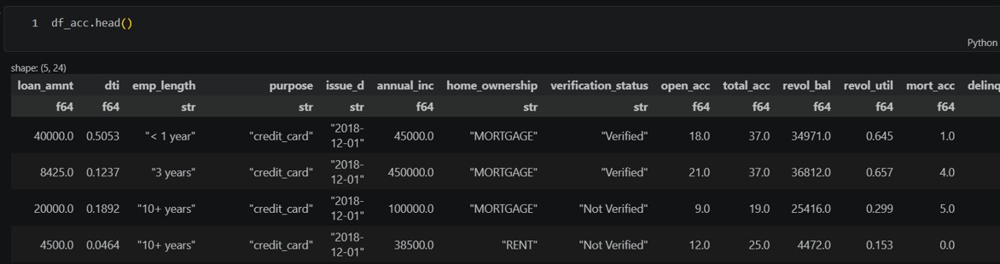

# Title

***Optimizing Dynamic Lending Policies for Bank Asset Liquidity Stability and Profit***

## Members

- Course: DGIST [CSE402] Reinforcement Learning
- Team 04.
  - 서정호 (2020-11101)
  - 김재환 (2021-11038)
  - 조후연 (2022-11195)

## Abstract

### Background

- Importance of liquidity stability of the bank's assets
- Maximizing the bank's loan-derived profit

### Overview [Not Proposal Slide]

- Record loan approvals per user at each loan approval point (monthly unit) → view the bank as the agent
- **(ML) Scoring Phase:** An ML model compresses each customer's complex feature set into a single **Total Risk Score**
  - Customer features → Total Risk Score → Loan condition mapping (2 ML models)
- **(RL) Policy Phase:** At the beginning of each month, the agent (bank) observes the current assets ($B_t$) and determines the **Loan Condition Mapping Action** based on the Total Risk Score
  - This function determines loan success and revenue/expenditure for that month
- **Input:** Borrower information
- **Output:** Optimal loan conditions per user, balancing (1) cash reserve stability and (2) lending profit

## Purpose

- **Goal:** We aim to derive an optimal lending policy that simultaneously maximizes long-term cumulative returns and preserves the liquidity stability of the bank's assets.

- **P1.** To construct an asset transition process based on the bank's monthly loan histories, incorporating both inflow (loan repayments) and outflow (newly approved loans).

- **P2. [ML1]** To construct a **Total Risk Score** per applicant by training a machine learning model that consolidates all available borrower features — including loan request amount, income, debt-to-income ratio, and credit history — into a single scalar value.
  - Agent == Bank 이기 때문에 each time $t$마다의 action을 결정하기 위한 feature 필요함.
  - But time $t$에서 every borrowers과의 interaction을 개별 집계하기 어려움.
  - 따라서 하나의 feature (Total Risk Score) 계산 하였음.

- **P3. [ML2]** A secondary ML model maps each applicant's Total Risk Score to a recommended set of loan conditions (e.g., interest rate, credit limit), enabling a structured and data-driven loan decision pipeline.

- **P4. [RL]** To learn an optimal policy via a reinforcement learning framework that balances asset liquidity stability and lending profitability.

## Research Question (RQ)

- **RQ1.** How does the mapping curve from risk score to loan conditions (action) dynamically change as the bank's budget state varies? (budget change → risk-score-to-action mapping change)

- **RQ2.** Is an RL agent based on monthly aggregated data more effective at preventing asset depletion than per-customer-level modeling? (Refer to existing models in the literature as performance baselines.)

## Key Literature Reviews

In the **Chang et al. (2022)**,

## Methodology

### Dataset: Lending Club [head() 정도만 slide에 넣기.]

- Show `head()` of the dataset with a brief description.
- **Temporal Aggregation:** Group the data by month based on `issue_d` (loan issuance month).
- **State Features:** Monthly applicant pool's average score distribution and the bank's current balance.
- **Reward/Transition Calculation:** For each month, compute the total repayments (Inflow) and total disbursed loans (Outflow) by aggregating per-user cash flows — summing each user's monthly repayment and loan amounts within that month.
  - Note: cases of delayed or non-repaying users must be carefully handled.

### ML Part

- **[ML1]** Borrower features $\to$ Total Risk Score
- **[ML2]** Total Risk Score $\to$ Loan condition recommendation (e.g., interest rate, loan period, …)

### RL Part - ML2와 동일 목적, but 더 성능이 좋게 나올 것으로 기대함.

- 기존 bank: ML2
- 우리 방식: RL
- 두개 비교!!

- Agent (Bank): train the policy for both asset liquidity stability and profit.

### 1. State ($S_t$)

- $B_t$: Bank's available budget (cash on hand) at time $t$ (monthly unit)
- $x_t^{pool}$: Total Risk Scores $P^t$ of loan applicants arriving in month $t$
- $L_t$: Total amount of outstanding (un-received) loan repayments after time $t$

### 2. Action ($A_t$)

$$A_t: P_i \to \text{Loan Condition}_i$$

- **Input:** Borrower $i$'s Total Risk Score $P_i$
- **Output:** Recommended loan condition per borrower (e.g., interest rate, credit limit)

### 3. Transition

$$B_{t+1} = B_t + \sum \text{Inflow}_t - \sum \text{Outflow}_t$$

- $B_{t+1} = B_t$: profit term
- $\text{Inflow}_t$: Total repayments received during month $t$
  - delayed 된 경우도 고려 필요. borrowers별로 상환금액 합. - scenario dependencey
- $\text{Outflow}_t$: Total amount disbursed as new loans during month $t$
  - 단순하게 계산 가능, summation 대출금액 그 시점 t에서

### 4. Reward ($R_t$)

$$R_t = (B_{t+1} - B_t) - \lambda \cdot \text{Penalty}(B_{t+1})$$

- $B_{t+1} = B_t$: profit term
- below: stability term - penalty

$$\text{Penalty}(B_{t+1}) = \exp\left[-\alpha \cdot \left(B_{t+1} - C_{\min}\right)\right], \quad \alpha > 0$$

- $C_{\min}$: Minimum budget the bank must maintain
- $\lambda$: Penalty weight (hyperparameter controlling the stability–profit tradeoff)
- $\alpha$: Decay rate controlling the sharpness of the penalty curve (hyperparameter)
  - When $B_{t+1} < C_{\min}$: penalty grows exponentially large
  - As $B_{t+1}$ decreases: penalty increases monotonically

### 5. Policy ($\pi^*$)

$$\pi^* = \arg\max_{\pi} \; \mathbb{E}\left[\sum_{t=0}^{T} \gamma^t R_t\right]$$

- $\gamma \in (0, 1)$: discount factor
- The optimal policy selects actions that maximize the expected long-term cumulative return

## Future Works

- Simulation-based data augmentation (if real data proves insufficient for training)

## References

1. An-Hsing Chang, Li-Kai Yang, Rua-Huan Tsaih, Shih-Kuei Lin. Machine learning and artificial neural networks to construct P2P lending credit-scoring model: A case using Lending Club data[J]. Quantitative Finance and Economics, 2022, 6(2): 303-325. doi: 10.3934/QFE.2022013

2. A. Brini, G. Tedeschi, and D. Tantari, "Reinforcement learning policy recommendation for interbank network stability," Journal of Economic Dynamics and Control, vol. 152, p. 104678, 2023.