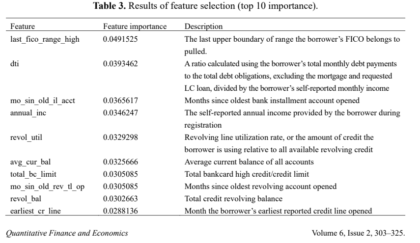
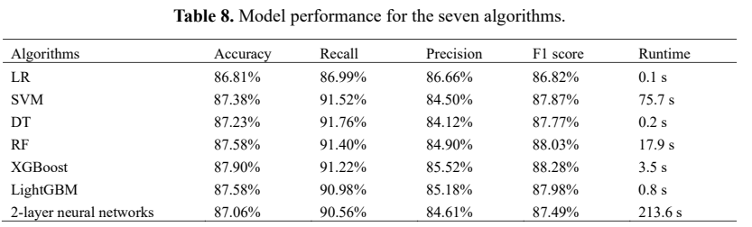

## Background

- Importance of **liquidity stability** of the bank's assets
- Maximizing the bank's **loan-derived profit**

## Purpose

- **Goal:** Derive an optimal lending policy that simultaneously maximizes long-term cumulative returns and preserves the bank's liquidity stability.
- **P1.** Asset transition process based on monthly inflow/outflow
- **P2. [ML1]** Borrower features → **Total Risk Score** (single scalar)
- **P3. [ML2]** Total Risk Score → Loan condition recommendation
- **P4. [RL]** Optimal policy balancing stability and profitability

## Research Questions

- **RQ1.** How does the risk-score-to-loan-condition mapping curve dynamically change as the bank's budget state varies?

- **RQ2.** Is an RL agent based on monthly aggregated data more effective at preventing asset depletion than per-customer-level modeling?

## Key Literature Reviews

Chang et al. (2022) — *P2P Lending Credit-Scoring Model using Lending Club data*

## Dataset: Lending Club

## ML Part

- **[ML1]** Borrower features $\to$ Total Risk Score
- **[ML2]** Total Risk Score $\to$ Loan condition recommendation (interest rate, loan period, …)

## RL Part — State ($S_t$)

- $B_t$: Bank's available budget at time $t$ (monthly unit)
- $x_t^{pool}$: Total Risk Scores $P^t$ of applicants arriving in month $t$
- $L_t$: Total outstanding (un-received) loan repayments after time $t$

## RL Part — Action ($A_t$)

$$A_t: P_i \to \text{Loan Condition}_i$$

- **Input:** Borrower $i$'s Total Risk Score $P_i$
- **Output:** Recommended loan condition (e.g., interest rate, credit limit)

## RL Part — Transition

$$B_{t+1} = B_t + \sum \text{Inflow}_t - \sum \text{Outflow}_t$$

- $\text{Inflow}_t$: Total repayments received during month $t$
- $\text{Outflow}_t$: Total disbursed as new loans during month $t$

## RL Part — Reward ($R_t$)

$$R_t = (B_{t+1} - B_t) - \lambda \cdot \text{Penalty}(B_{t+1})$$

$$\text{Penalty}(B_{t+1}) = \exp\left[-\alpha \cdot \left(B_{t+1} - C_{\min}\right)\right], \quad \alpha > 0$$

- $C_{\min}$: Minimum budget the bank must maintain
- $\lambda$: Stability–profit tradeoff (hyperparameter)
- $\alpha$: Sharpness of penalty curve (hyperparameter)

## RL Part — Policy ($\pi^*$)

$$\pi^* = \arg\max_{\pi} \; \mathbb{E}\left[\sum_{t=0}^{T} \gamma^t R_t\right]$$

- $\gamma \in (0, 1)$: discount factor
- Selects actions maximizing expected long-term cumulative return

## Future Works

- Simulation-based data augmentation (if real data proves insufficient for training)

## References

1. Chang et al. (2022). Machine learning and ANN to construct P2P lending credit-scoring model. *Quantitative Finance and Economics*, 6(2), 303–325. doi: 10.3934/QFE.2022013

2. Brini, Tedeschi & Tantari (2023). Reinforcement learning policy recommendation for interbank network stability. *Journal of Economic Dynamics and Control*, 152, 104678.