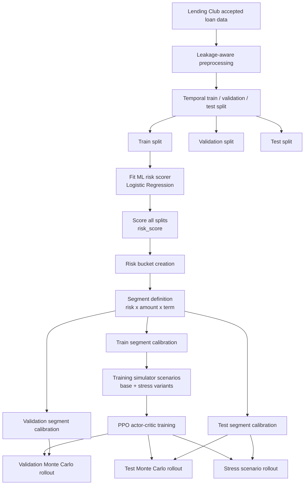
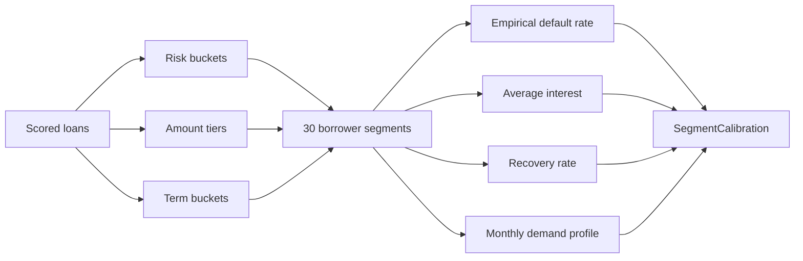

# 최종 보고서 초안용 구조도 문서

프로젝트 주제:

```text
Simulation-Based Reinforcement Learning for Bank-Level
Liquidity-Constrained Monthly Lending Allocation
```

한국어 주제:

```text
은행 수준의 유동성 제약 월별 대출 자금배분을 위한
시뮬레이션 기반 강화학습
```

이 문서는 최종 보고서 초안에 바로 옮길 수 있도록 전체 방법론, 구조도, 수식, 평가 프로토콜, 결과표, 한계점을 파트별로 정리한다.

---

## 1. 전체 연구 파이프라인

### 1.1 핵심 흐름

본 연구는 Lending Club historical data를 직접적인 offline RL trajectory로 사용하지 않는다. 대신 historical data는 borrower risk, segment-level default behavior, recovery, interest, monthly demand를 추정해 **시뮬레이터를 보정하는 재료**로 사용된다. 강화학습 policy는 이 보정된 simulator 안에서 학습되고, validation/test period 통계로 보정된 out-of-time simulator scenario에서 평가된다.

```text
Lending Club Data
→ ML Risk Scoring
→ Segment Calibration
→ Bank Lending Simulator
→ PPO Policy Training
→ Monte Carlo Evaluation
```

### 1.2 구조도



### 1.3 중요한 방법론 경계

Historical Lending Club data는 과거 플랫폼/시장 조건에서 생성된 결과만 포함한다. 따라서 learned PPO policy가 다른 lending allocation을 선택했을 때의 counterfactual cash flow는 historical test set에 직접 존재하지 않는다.

따라서 본 연구의 성능 claim은 다음과 같이 제한된다.

```text
본 연구는 실제 Lending Club 시장에서 최적 정책을 증명하는 것이 아니라,
Lending Club 데이터로 보정한 simulated lending environment에서
PPO policy가 baseline보다 나은 profit-liquidity trade-off를 보이는지 평가한다.
```

---

## 2. 데이터 처리 구조

### 2.1 사용 데이터

사용 데이터는 Lending Club accepted loan records이다. rejected applications는 관측되지 않으므로, 본 연구의 monthly demand는 전체 신청자 풀이라기보다 **historically accepted loan flow의 proxy**로 해석한다.

사용 범위:

```text
archive 2/accepted_2007_to_2018Q4.csv.gz
```

주요 사용 컬럼:

| 목적 | 예시 컬럼 |
|---|---|
| borrower feature | income, DTI, FICO, delinquency, employment, purpose |
| loan amount / term | loan amount, funded amount, term |
| outcome calibration | default / charged-off label, recovery |
| monthly demand | issue month |

### 2.2 Temporal split

최종 pipeline은 random split이 아니라 issue month 기준 temporal split을 사용한다.

```text
train      70%
validation 20%
test       10%
```

최종 run 기준 effective rows:

| Split | Rows |
|---|---:|
| Train | 32,803 |
| Validation | 35,256 |
| Test | 4,696 |
| Total after cleaning | 72,755 |

Temporal split을 쓰는 이유는 policy가 과거 데이터로 calibration된 환경에서 학습된 뒤, 미래 기간의 distribution shift에 대해 평가되는 형태를 만들기 위해서다.

### 2.3 Leakage 방지

ML risk scorer에는 사후 결과 또는 historical loan policy proxy가 들어가면 안 된다. 특히 다음 변수들은 borrower risk를 예측하는 입력 feature에서 제외했다.

| 제외 변수 | 제외 이유 |
|---|---|
| `loan_status` | outcome label |
| `total_pymnt` | 사후 총 회수액 |
| `total_rec_prncp` | 사후 원금 회수액 |
| `total_rec_int` | 사후 이자 회수액 |
| `recoveries` | default 후 회수 결과 |
| `collection_recovery_fee` | default 후 collection 결과 |
| `last_pymnt_d` | 사후 payment 정보 |
| `last_pymnt_amnt` | 사후 payment 정보 |
| `out_prncp` | 사후 outstanding 정보 |
| `int_rate` | historical loan pricing / underwriting proxy |
| `installment` | historical loan condition proxy |
| `grade` | Lending Club historical risk grade |
| `sub_grade` | Lending Club historical risk grade |

### 2.4 Risk scorer 입력 feature

최종 risk scorer 입력 feature는 borrower-side 또는 origination-time 정보 위주로 구성했다.

```text
loan_amnt
funded_amnt
annual_inc
dti
delinq_2yrs
fico_range_low
fico_range_high
fico_avg
inq_last_6mths
open_acc
pub_rec
revol_bal
revol_util
total_acc
term_months
acc_open_past_24mths
mort_acc
pub_rec_bankruptcies
emp_length
home_ownership
verification_status
purpose
application_type
```

---

## 3. ML Risk Scoring

### 3.1 사용 모델

ML risk scorer는 `Logistic Regression`을 사용했다.

사용 이유:

1. default probability 해석이 쉽다.
2. feature leakage 여부를 점검하기 쉽다.
3. 딥러닝 모델보다 보고서에서 calibration 단계로 설명하기 간결하다.
4. 본 프로젝트의 핵심은 ML 분류 성능이 아니라 RL 자본배분이므로, 과도하게 복잡한 ML 모델을 쓰지 않는 편이 역할 분리에 적합하다.

### 3.2 ML의 역할

ML은 최종 대출 의사결정을 하지 않는다. ML의 역할은 borrower별 risk score를 만들고, 이 risk score를 사용해 borrower를 risk bucket으로 나누는 것이다.

```text
ML predicts risk.
RL allocates bank capital.
```

즉:

```text
Borrower features → Logistic Regression → risk_score
risk_score → risk bucket
```

ML output은 simulator의 최종 policy action이 아니다. 최종 action은 PPO가 segment별 lending capital allocation으로 결정한다.

### 3.3 Risk scorer 성능

최종 run 기준:

| Metric | Value |
|---|---:|
| Validation AUC | 0.700 |
| Test AUC | 0.675 |
| Overall bad rate | 0.210 |

이 정도 성능은 credit default prediction에서 완벽하지는 않지만, borrower를 broad risk segment로 나누기 위한 calibration signal로는 사용할 수 있다.

---

## 4. Segment Calibration

### 4.1 Segment 정의

Borrower는 다음 세 기준의 조합으로 segment화한다.

```text
segment = risk bucket × loan amount tier × term bucket
```

기본 설정:

| 구성 요소 | 개수 |
|---|---:|
| Risk bucket | 5 |
| Loan amount tier | 3 |
| Term bucket | 2 |
| Total segment count | 5 × 3 × 2 = 30 |

예시:

| Segment 예시 | 의미 |
|---|---|
| low risk × small amount × 36 months | 저위험, 소액, 단기 대출 |
| medium risk × medium amount × 60 months | 중위험, 중간 금액, 장기 대출 |
| high risk × large amount × 60 months | 고위험, 고액, 장기 대출 |

### 4.2 Segment별 추정값

각 segment `j`에 대해 다음 파라미터를 historical data에서 추정한다.

| Parameter | 의미 | Simulator에서의 역할 |
|---|---|---|
| `PD_j` | segment-level empirical default probability | default hazard 계산 |
| `interest_j` | 평균 연이자율 | interest income 계산 |
| `recovery_j` | default 후 회수율 | recovery cash flow 계산 |
| `expected_profit_rate_j` | deterministic runoff 기반 기대수익률 | PPO observation 및 greedy/LP baseline score |
| `monthly_demand_j` | 월별 segment demand amount | 신규 대출 수요 생성 |

중요한 점은 simulator의 segment-level default probability가 단순히 `mean(risk_score) × scale`이 아니라, segment 내부의 empirical bad-loan rate에서 calibration된다는 점이다. Risk score는 segment를 만들기 위한 ranking signal로 사용되고, segment behavior는 data statistics에서 추정한다.

### 4.3 Calibration 구조도



---

## 5. Simulator / MDP 구조

### 5.1 MDP 정의

본 문제는 다음 MDP로 정의된다.

```text
M = (S, A, P, R, gamma, T)
```

월별 decision horizon:

```text
t = 0, 1, ..., T
T = 36 months
```

### 5.2 State

최종 state는 다음과 같다.

```text
S_t = (B_t, G_t, E_t, theta)
```

| State component | 의미 |
|---|---|
| `B_t` | 현재 cash budget / liquidity |
| `G_t` | 이번 달 segment별 applicant demand |
| `E_t` | segment-by-maturity outstanding exposure |
| `theta` | segment별 calibration parameters |

기본 차원:

```text
J = 30 segments
H = 6 maturity buckets
theta_j = (PD_j, interest_j, recovery_j, expected_profit_rate_j)

state dimension = 1 + J + JH + 4J
                = 1 + 30 + 30×6 + 4×30
                = 331
```

### 5.3 Action

Action은 scalar threshold가 아니라 30차원 continuous capital allocation vector이다.

```text
A_t = x_t = (x_t,1, x_t,2, ..., x_t,J)
```

각 원소는 해당 segment에 배정할 신규 lending capital이다.

제약:

```text
0 ≤ x_t,j ≤ G_t,j
```

즉, segment demand보다 많이 빌려줄 수 없다.

Actor network는 직접 dollar amount를 출력하지 않고, 다음 raw action을 출력한다.

```text
actor(S_t) → deployment fraction + segment weights
```

그 후 environment가 이를 feasible allocation으로 변환한다.

```text
(u_t, w_t) → x_t
```

### 5.4 Transition

월별 budget transition은 다음 cash-flow 항목으로 구성된다.

```text
B_{t+1}
= B_t
+ repayments
+ recoveries
- funding cost
- servicing cost
- inflation cost
- new disbursement
```

Loan book transition은 다음과 같다.

```text
E_{t+1}
= UpdateLoanBook(E_t, x_t, defaults, repayments, maturity aging)
```

Transition 요소:

| 요소 | 설명 |
---|---|
| repayment | 기존 loan book에서 원금상환 |
| default loss | defaulted exposure 중 회수되지 못한 손실 |
| recovery | defaulted exposure 중 회수되는 금액 |
| funding cost | outstanding exposure를 유지하기 위한 funding 비용 |
| servicing cost | loan servicing 비용 |
| inflation cost | idle cash의 실질가치 하락 |
| new disbursement | 이번 달 신규 대출 실행액 |

---

## 6. Reward 및 Constraint

### 6.1 Period profit

월별 profit은 다음과 같이 정의한다.

```text
period_profit_t
= interest_income_t
- default_loss_t
- funding_cost_t
- servicing_cost_t
- cash_inflation_cost_t
```

현금만 최대화하면 대출을 전혀 하지 않는 reject-all이 최적이 되므로, objective는 cash balance 자체가 아니라 profit과 liquidity risk의 균형이다.

### 6.2 Liquidity requirement

Required liquidity는 minimum cash reserve와 outstanding exposure 기반 reserve로 구성된다.

```text
RequiredLiquidity_t
= B_min + kappa × OutstandingExposure_t
```

여기서:

```text
B_min = min_cash_ratio × initial_cash
kappa = reserve_exposure_ratio
```

최종 run 기준:

| Parameter | Value |
|---|---:|
| `initial_cash` | $50M |
| `min_cash_ratio` | 0.20 |
| `B_min` | $10M |
| `reserve_exposure_ratio` | 0.05 |

### 6.3 Liquidity penalty

Liquidity shortfall:

```text
shortfall_t = [RequiredLiquidity_t - B_t]_+
```

Reward:

```text
R_t
= period_profit_t / initial_cash
- lambda × (shortfall_t / initial_cash)^2
```

최종 선택:

```text
lambda = 1.0
```

### 6.4 Capital adequacy / liquidation rule

평가에서는 단순 penalty만 보지 않고, breach가 발생하면 episode를 즉시 청산한다.

Capital adequacy:

```text
CAR_t = capital_t / risk_weighted_assets_t
```

최소 기준:

```text
min CAR = 8%
```

청산 조건:

```text
if liquidity breach or capital adequacy breach:
    liquidate episode
```

Liquidity liquidation은 현재 자산에 60% haircut을 적용한다.

```text
current_assets = cash_budget + outstanding loan-book exposure
liquidation_loss = 0.60 × current_assets
liquidation_proceeds = 0.40 × current_assets
```

청산되면 이후 terminal runoff나 terminal value는 credited 되지 않는다.

---

## 7. PPO 강화학습 구조

### 7.1 사용한 강화학습 기법

사용 알고리즘:

```text
PPO: Proximal Policy Optimization
```

구조:

```text
Attention Actor-Critic PPO
```

### 7.2 Actor-Critic 구조

| 구성 | 역할 |
|---|---|
| Actor | 현재 state를 보고 segment별 allocation policy 출력 |
| Critic | 현재 state의 expected long-term value 추정 |

Actor:

```text
π_θ(a_t | s_t)
```

Critic:

```text
V_ϕ(s_t)
```

PPO는 rollout에서 얻은 advantage를 사용해 actor를 업데이트하고, value loss를 사용해 critic을 업데이트한다. Policy update는 clipping을 통해 너무 급격하게 변하지 않도록 제한된다.

### 7.3 Attention layer를 사용한 이유

본 문제는 30개 segment 중 어디에 자금을 배분할지 비교하는 문제다. 각 segment는 PD, interest, recovery, expected profit, demand, exposure를 가진다. 따라서 단순 MLP보다 segment를 token처럼 보고 서로 비교하는 attention 구조가 자연스럽다.

```text
segment features
→ attention encoder
→ segment allocation logits
→ capital allocation weights
```

Attention의 역할:

1. segment 간 상대적 매력도 비교
2. risk-return trade-off ranking
3. demand와 outstanding exposure를 함께 고려
4. high-risk segment에 대한 allocation 억제

### 7.4 왜 DQN/Q-learning이 아닌 PPO인가

DQN/Q-learning은 discrete action에 적합하다. 그러나 본 연구의 action은 30차원 continuous allocation vector이다.

```text
x_t ∈ R_+^30
```

이를 DQN으로 처리하려면 모든 allocation 조합을 discretize해야 하며, 가능한 action 수가 폭발한다. 예를 들어 30개 segment에 자본을 10단계로 나누어 배분해도 조합 수가 매우 커진다.

따라서 본 연구에서는 continuous action을 직접 다룰 수 있고, 구현 안정성이 좋은 PPO actor-critic을 사용했다.

---

## 8. Evaluation Protocol

### 8.1 Monte Carlo rollout

각 policy는 동일한 simulator setting에서 여러 random seed로 평가된다.

최종 run:

```text
eval episodes = 100
```

각 episode에서는:

1. monthly demand sample 생성
2. policy가 segment allocation 선택
3. simulator가 repayment/default/recovery/cost/disbursement 반영
4. liquidity/capital breach 여부 확인
5. horizon 종료 후 terminal runoff 수행

### 8.2 Validation/Test 해석

Validation/test는 실제 counterfactual ground truth가 아니다. 즉 historical test data에서 PPO가 실제로 선택했을 action의 realized cash flow를 관측한 것이 아니다.

정확한 표현:

```text
Validation/test period statistics are used to calibrate out-of-time
simulation scenarios. Learned policies are evaluated through Monte Carlo
rollouts in those calibrated simulators.
```

한국어:

```text
Validation/test는 historical policy-value 정답지가 아니라,
out-of-time simulator calibration scenario이다.
```

### 8.3 Baselines

| Baseline | 설명 |
|---|---|
| `reject_all` | 모든 신규 대출 거절 |
| `fixed_conservative` | 보수적 segment에만 고정 배분 |
| `fixed_aggressive` | 더 넓은 segment에 공격적 고정 배분 |
| `greedy_expected_profit` | expected profit rate가 높은 segment부터 배분 |
| `budget_aware_heuristic` | budget 상태에 따라 공격성 조절 |
| `one_step_lp_closed_form` | myopic linear programming의 closed-form greedy solution |

`one_step_lp_closed_form`은 단일 budget constraint와 linear per-dollar profit coefficient를 갖는 one-step LP가 expected profit rate 순서대로 capacity를 채우는 greedy solution으로 풀리기 때문에 `greedy_expected_profit`과 같은 결과가 나올 수 있다.

---

## 9. 결과 표 및 해석

최종 보고서의 핵심 결과는 다음 run을 기준으로 한다.

```text
outputs/segment_ppo_800_lambda1_inflation25_ppo_only_final_run
```

주요 설정:

| 항목 | 값 |
|---|---:|
| PPO episodes | 800 |
| rollout episodes | 16 |
| eval episodes | 100 |
| horizon | 36 months |
| terminal runoff | 60 months |
| initial cash | $50M |
| expected inflation | 2.5% annual |
| lambda | 1.0 |
| terminal value weight | 0.0 |
| simulator backend | torch / MPS |

### 9.1 Validation result

단위: USD.

| Policy | Cumulative Profit | Decision-period Profit | Terminal Runoff Profit | Liquidation |
|---|---:|---:|---:|---:|
| PPO RL | 1,258,559 | 98,328 | 1,160,231 | 0/100 |
| Reject-all | -3,577,121 | -3,577,121 | 0 | 0/100 |
| Fixed conservative | -29,995,382 | -29,995,382 | 0 | 100/100 |
| Greedy expected profit | -30,000,008 | -30,000,008 | 0 | 100/100 |
| One-step LP | -30,000,008 | -30,000,008 | 0 | 100/100 |
| Fixed aggressive | -30,004,130 | -30,004,130 | 0 | 100/100 |
| Budget-aware heuristic | -30,004,130 | -30,004,130 | 0 | 100/100 |

### 9.2 Test result

단위: USD.

| Policy | Cumulative Profit | Decision-period Profit | Terminal Runoff Profit | Liquidation |
|---|---:|---:|---:|---:|
| PPO RL | 403,011 | -489,843 | 892,855 | 0/100 |
| Reject-all | -3,577,121 | -3,577,121 | 0 | 0/100 |
| Greedy expected profit | -29,998,110 | -29,998,110 | 0 | 100/100 |
| One-step LP | -29,998,110 | -29,998,110 | 0 | 100/100 |
| Fixed conservative | -30,003,372 | -30,003,372 | 0 | 100/100 |
| Fixed aggressive | -30,004,312 | -30,004,312 | 0 | 100/100 |
| Budget-aware heuristic | -30,006,722 | -30,006,722 | 0 | 100/100 |

### 9.3 결과 해석

PPO는 test scenario에서 청산 없이 양의 누적수익을 기록했다.

```text
PPO test profit = +$0.40M
PPO liquidation = 0/100
```

Reject-all은 청산은 없지만, idle cash inflation drag 때문에 음의 수익을 기록했다.

```text
Reject-all test profit = -$3.58M
```

Greedy, LP, fixed policies는 수익성이 좋아 보이는 segment에 과도하게 배분하면서 liquidity/capital rule을 위반했고, 모든 episode에서 청산되었다.

```text
Heuristic lending baselines liquidation = 100/100
```

즉 PPO는 단순히 대출을 많이 하는 것이 아니라, 청산을 피할 정도로 exposure를 조절하면서 reject-all보다 나은 수익을 만든다.

### 9.4 Terminal runoff 분리

PPO test result는 다음 구조다.

```text
decision-period profit = -$0.49M
terminal runoff profit = +$0.89M
terminal value         = $0
total                 = +$0.40M
```

`terminal_value_weight=0`이므로 결과가 임의적 terminal NPV 보정으로 부풀려진 것은 아니다. 다만 decision horizon 중 발생한 손익과 horizon 이후 runoff 손익을 분리해서 보고해야 한다.

### 9.5 Stress test result

단위: USD.

| Stress Scenario | PPO Profit | PPO Liquidation | 해석 |
|---|---:|---:|---|
| High-risk demand 1.5x | 401,118 | 0/100 | 정상 test와 유사하게 안정적 |
| Liquidity 0.7x | 278,076 | 0/100 | 초기 유동성 감소에도 생존 |
| Recovery 0.5x | -53,041 | 0/100 | 거의 손익분기 |
| Default 2x | -11,338,207 | 0/100 | 생존하지만 수익성 크게 악화 |
| Combined stress | -4,042,391 | 0/100 | 생존하지만 reject-all보다 불리 |

Stress 결과는 PPO가 청산을 잘 피하지만, default shock이 극단적으로 커지면 대출 자체가 손실을 만들 수 있음을 보여준다.

---

## 10. 한계점 및 해석 범위

### 10.1 Accepted loans만 사용한 한계

Lending Club accepted loans는 전체 applicant pool이 아니다. rejected applicants가 없으므로, simulator의 monthly demand는 실제 시장 전체 수요가 아니라 accepted loan flow의 proxy이다.

따라서 본 연구는:

```text
If the bank faces demand similar to historically accepted Lending Club loans...
```

라는 조건부 simulation으로 해석해야 한다.

### 10.2 Real-world optimal policy가 아님

본 연구는 실제 Lending Club market에서 PPO가 최적임을 증명하지 않는다. Historical data는 behavior policy 아래에서 생성된 결과이고, PPO policy가 선택했을 counterfactual action의 실제 결과는 관측되지 않는다.

정확한 claim:

```text
PPO outperforms baselines in a simulated lending environment calibrated from
Lending Club data.
```

### 10.3 Default shock에서 PPO도 손실 가능

Default rate가 2배로 증가한 stress scenario에서는 PPO도 큰 손실을 기록했다. 이는 policy 실패라기보다, 대출 asset 자체의 economics가 악화되면 안전한 lending policy도 수익을 내기 어렵다는 것을 보여준다.

### 10.4 Segment-level approximation

Borrower-level individual policy가 아니라 segment-level allocation이다. 따라서 segment 내부의 heterogeneity는 평균화된다. 이는 계산 가능성과 해석 가능성을 높이지만, 개별 borrower 선별 능력은 제한한다.

### 10.5 Simulator assumption

Default hazard, recovery, repayment, maturity aging은 단순화된 simulator assumption에 기반한다. 결과는 simulator assumption에 의존하므로, 실제 은행 도입 전에는 더 정교한 cash-flow/default/prepayment model이 필요하다.

---

## 11. 보고서용 핵심 문장

최종 보고서 conclusion에 사용할 수 있는 문장:

```text
We formulate lending as a bank-level monthly capital allocation problem under
liquidity and capital constraints. Historical Lending Club data is used to
calibrate a segment-level lending simulator, rather than to directly evaluate
counterfactual policy values. A PPO actor-critic policy observes current cash,
segment demand, outstanding exposure, and segment-level risk-return parameters,
then allocates lending capital across 30 borrower segments. In the calibrated
test simulator, PPO achieves positive cumulative profit with zero liquidation
episodes, while fixed and greedy lending baselines are liquidated in all
evaluation episodes. This suggests that simulator-trained RL can improve the
profit-liquidity trade-off under the modeled assumptions.
```

한국어 버전:

```text
본 연구는 대출 문제를 개별 차주 승인 문제가 아니라 은행 수준의 월별 자본배분 문제로 재정의하였다. Lending Club historical data는 learned policy의 counterfactual 성능을 직접 평가하는 데 사용하지 않고, segment-level lending simulator를 보정하는 데 사용하였다. PPO actor-critic policy는 현재 현금, segment별 수요, outstanding exposure, segment별 risk-return parameter를 관측하고 30개 borrower segment에 자본을 배분한다. 보정된 test simulator에서 PPO는 청산 없이 양의 누적수익을 달성한 반면, fixed 및 greedy lending baseline은 모든 evaluation episode에서 청산되었다. 이는 본 simulator assumption 하에서 RL policy가 profit-liquidity trade-off를 개선할 수 있음을 보여준다.
```
